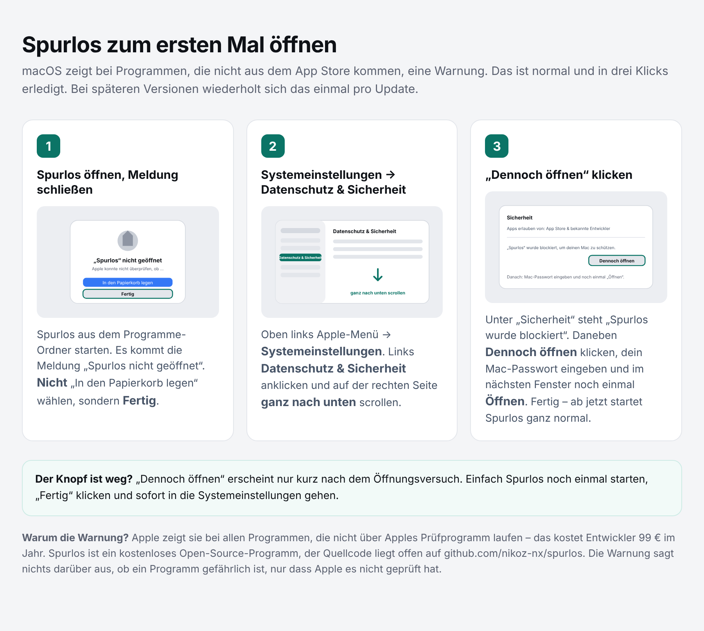

# Spurlos

Spurlos schreibt Datenhändler für dich an und verlangt Auskunft, Widerspruch gegen Werbung und Löschung deiner Daten. Es verschickt die Anfragen nach und nach aus einem eigenen Postfach, erkennt die Antworten, achtet auf die Fristen und erinnert Firmen, die nicht antworten. Bleibt eine Firma stumm, bereitet es einen Beschwerde-Text für die Datenschutzbehörde vor.

Die Liste umfasst rund 200 geprüfte Firmen aus Deutschland, Österreich, der Schweiz, der EU, Großbritannien und den USA. Welche davon angeschrieben werden, richtet sich nach den Ländern, die du angibst. Firmen in der Schweiz bekommen Briefe nach dem Schweizer Datenschutzgesetz.

Spurlos läuft nur auf deinem Mac. Es gibt keinen Server und kein Benutzerkonto.

## Was du brauchst

- Einen Mac mit Apple-Chip (M1 oder neuer) und macOS 12 oder neuer
- Ein eigenes E-Mail-Postfach nur für Spurlos, zum Beispiel bei deinem Webhoster, GMX, WEB.DE, iCloud oder Gmail

## Installieren

1. Die neueste **Spurlos-x.y.z.dmg** unter [Releases](https://github.com/nikoz-nx/spurlos/releases) herunterladen und öffnen.
2. **Spurlos** in den Ordner **Programme** ziehen.
3. Spurlos aus „Programme“ starten. macOS zeigt eine Warnung, siehe nächster Abschnitt.
4. Danach öffnet sich die Einrichtung in fünf Schritten.

Fragt macOS später einmal nach dem Zugriff auf den Schlüsselbund, klick auf **„Immer erlauben“**. Spurlos liest nur seinen eigenen Eintrag, nicht deine anderen Passwörter.

## Erster Start: die Warnung von macOS

Beim ersten Öffnen sagt macOS „Spurlos nicht geöffnet“. Das ist normal bei Programmen, die nicht über Apples kostenpflichtiges Prüfprogramm laufen. So geht es weiter (die Anleitung liegt auch als Datei im Download):

1. Meldung mit **Fertig** schließen (nicht „In den Papierkorb legen“).
2. Apple-Menü → **Systemeinstellungen** → **Datenschutz & Sicherheit**, rechts ganz nach unten scrollen.
3. Bei „Spurlos wurde blockiert“ auf **Dennoch öffnen** klicken, Mac-Passwort eingeben, noch einmal **Öffnen**.

Das wiederholt sich einmal pro neu heruntergeladener Version. Dein gespeichertes Postfach-Passwort bleibt davon unberührt.

## Benutzen

- Spurlos arbeitet, solange es läuft: Dann verschickt es Anfragen und ruft das Postfach ab. Das Fenster kannst du schließen, Spurlos läuft im Hintergrund weiter (Symbol im Dock). Ein Klick aufs Dock-Symbol holt das Fenster zurück.
- Die Anfragen gehen einzeln raus, zwischen 8 und 20 Uhr, am ersten Tag wenige, danach mehr. So landen sie nicht im Spam. Spurlos zeigt dir, in wie vielen Tagen alle verschickt sind.
- Schläft dein Mac oder ist Spurlos beendet, holt es alles beim nächsten Start nach.
- Beenden über das Menü „Spurlos → Spurlos beenden“ oder mit ⌘Q. Eine gerade laufende Mail wird noch fertig verschickt.

## Aus dem Quellcode starten (für Entwickler)

Im Terminal: `python3 -m spurlos` startet Spurlos und öffnet die Oberfläche im Browser. Braucht Python 3.9 oder neuer, `flask` und `keyring`. Die Mac-App wird mit `packaging/Spurlos.spec` (PyInstaller) gebaut, siehe `.github/workflows/mac-app.yml`.

## Deine Daten

- Alles liegt in `~/Library/Application Support/Spurlos`.
- Das Passwort deines Postfachs und ein KI-Schlüssel liegen im Schlüsselbund deines Macs.
- Ein Protokoll für die Fehlersuche liegt daneben (`spurlos.log`), ohne Passwörter. Unter **Einstellungen › Daten & Sicherung** kannst du es im Finder zeigen lassen.
- Unter **Einstellungen › Daten & Sicherung** kannst du eine Sicherung exportieren oder alles löschen.

## KI (optional)

Spurlos erkennt Antworten auch ohne KI. Wenn du willst, hilft eine KI bei ungewöhnlichen Antworten:

- **Apple Intelligence**: läuft auf deinem Mac, kostenlos. Braucht macOS 26 und einen Mac mit Apple-Chip.
- **Ollama**: ein freies Modell auf deinem Mac, kostenlos, braucht viel Speicher. Gibt es auf ollama.com.
- **Cloud-KI** (Claude oder ChatGPT): braucht einen API-Schlüssel und kostet pro Nutzung. Der Text der Antworten geht dann an den Anbieter.

Egal welche Einstellung: Spurlos verschickt nichts, bevor du einen Vorschlag bestätigt hast.

## Entfernen

1. In Spurlos unter **Einstellungen › Daten & Sicherung** auf „Alle Daten löschen“.
2. Spurlos aus „Programme“ in den Papierkorb legen.

## Hinweise

Spurlos hilft dir, deine Rechte nach der Datenschutz-Grundverordnung und dem Schweizer Datenschutzgesetz wahrzunehmen. Es ersetzt keine Rechtsberatung.

Die Firmenliste stammt aus der offenen Datenbank von datenanfragen.de (CC0), der öffentlichen Liste von Incogni, dem Datenhändler-Register des US-Bundesstaats Kalifornien und eigener Recherche. Die Kontaktadressen wurden im November 2026 auf den Datenschutzseiten der Firmen geprüft. Kontaktdaten können sich ändern. Wenn eine Mail nicht zugestellt wird, zeigt Spurlos das an, und du kannst die Adresse in der Händlerliste korrigieren.

Schrift: IBM Plex (SIL Open Font License).

## Ohne Gewähr

Spurlos wird kostenlos und ohne jede Gewähr bereitgestellt. Jeder Nutzer verschickt die Anfragen in seinem eigenen Namen, aus seinem eigenen Postfach, und ist für deren Inhalt und Versand selbst verantwortlich. Die Entwickler haften nicht für Schäden, die aus der Nutzung entstehen.

## Lizenz

Copyright (C) 2026 die Spurlos-Autoren (github.com/nikoz-nx/spurlos)

Spurlos ist freie Software: Du darfst es unter den Bedingungen der GNU General Public License, Version 3, nutzen, verändern und weitergeben. Wer eine veränderte Fassung weitergibt, muss deren Quellcode ebenfalls unter dieser Lizenz offenlegen. Den vollständigen Text findest du in der Datei [LICENSE](LICENSE).
